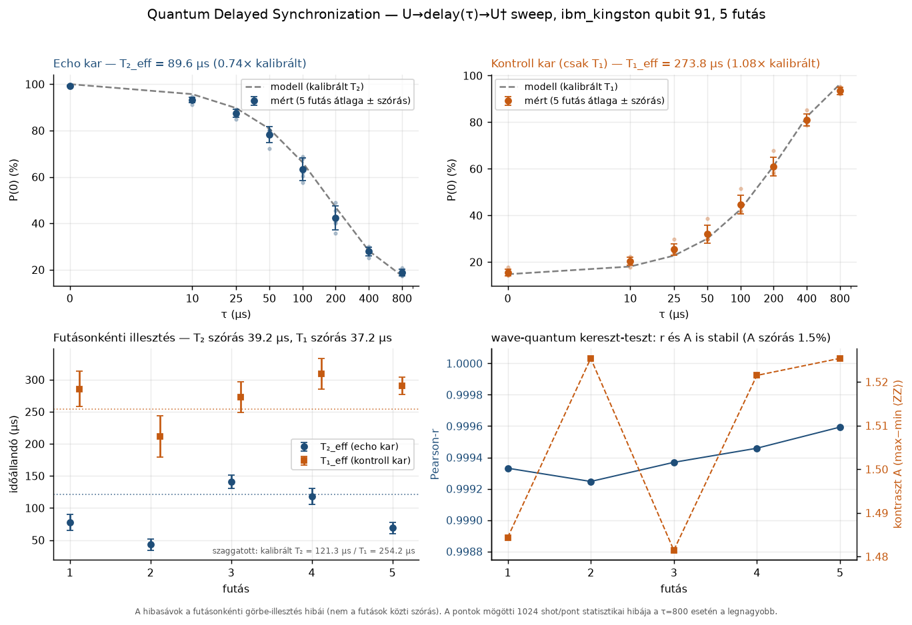

# Quantum Delayed Synchronization (QDS)

> Delayed echoes — synchronizing the memory spine with quantum states
> **Measured on real IBM hardware since 2026-10-18** (`ibm_kingston`, qubit 91).

[Hungarian version](README.md)

## What do we measure?

QDS investigates coherent synchronization between the memory spine and quantum
state. The experiment is a random-axis **Hahn-echo (U-delay-U†) sweep**:

| arm | circuit | depends on |
|---|---|---|
| **echo** | `U → delay(τ) → U†` | T₂ (phase coherence) |
| **control** | `U → delay(τ)` | **T₁ only** (relaxation) |

8 τ values (0…800 µs), one fixed qubit, 1024 shots/circuit, 5 runs.

The **control arm is not decoration**: because it depends on T₁ alone, it is the
*arbiter* of the time axis. A hidden time-scaling error would shift both curves
by the **same** ratio, so the T₁ ratio tells us whether the T₂ deficit is real
decoherence or merely a wrong `dt` assumption. See
[`docs/QDS_CHRONICLE.md`](docs/QDS_CHRONICLE.md), Phase 4.

## Main result

| quantity | value |
|---|---|
| Calibrated T₂ (qubit 91) | 121.3 µs |
| **Echo-limited T₂_eff** | **89.6 ± 17.5 µs** (SEM, 5 runs) — ratio **0.74 ± 0.15** |
| T₁ from the control arm | 273.8 ± 37.2 µs → ratio **1.08** → **time axis is correct** |
| Run-to-run spread | T₂_eff σ = 39.2 µs (43–141 µs), **3.6×** the computed noise, χ² = 60.9 (p ≈ 2·10⁻¹²) |
| T₁ spread | χ² = 7.7 (p = 0.10) → **not** significant |

The T₂ deficit is **not a measurement error**: IBM's calibration assumes a
static frequency, while a random-axis echo cannot refocus frequency drift
during the delay. The fact that relaxation (T₁) is stable while phase coherence
(T₂) wanders from run to run is exactly what the drift hypothesis predicts.

> **What this does NOT prove** — no new physics, and nothing about the Hope
> architecture. The itemised limits are in
> [`docs/QDS_REFEREE_STATS.md`](docs/QDS_REFEREE_STATS.md).



*Four panels: the echo and control arms against the calibrated model, the
per-run fit (T₂ vs. T₁), and the wave-quantum cross-test. Regenerate with
`qds_plots.py` — no token, no quota.*

## Install

Python ≥ 3.10. For hardware work use a **dedicated venv** (never the global
Python):

```bash
python -m venv .venv-qds
. .venv-qds/bin/activate            # Windows: .venv-qds\Scripts\activate

# simulator + analysis (enough for most work)
pip install -e ".[dev]"

# hardware runs additionally need:
pip install -e ".[hardware]"
```

> The previous docs used Windows-only `.venv-qds\Scripts\python.exe` paths —
> the commands are now platform independent.

## Running

```bash
# 1. simulator (free, ~3 s) — MEDIAN noise model, NOT qubit 91
python hahn_echo_t2_qam.py --mode simulate

# 2. quota-free preflight checks
python qds_env_check.py            # versions, delay→dt conversion
python qds_preflight.py            # backend, qubit, quota (needs token)
python qds_target_probe.py         # dt/granularity, best-T₂ qubits

# 3. hardware — ALWAYS dry-run first (consumes no quota)
python hahn_echo_t2_qam.py --mode hardware --dry-run

# 4. live hardware measurement (CONSUMES IBM QUOTA)
python hahn_echo_t2_qam.py --mode hardware

# 5. repeated runs, time-spaced (to expose drift; CONSUMES QUOTA)
python qds_replicates.py --runs 4 --delay 75

# 6. analysis (no quota; works on the committed data)
python qds_multirun_stats.py       # results/multirun_stats.json
python qds_analyze.py              # results/qam_echo_t2_results.json
python qds_detectability.py        # χ² test: drift vs. shot noise
python qds_axis_arbitration.py     # time axis vs. real decoherence

# 7. tools that also run without quota (from the existing data)
python qds_robustness.py           # bootstrap CIs, weighting, τ-range sweep
python qds_plots.py                # results/figures/qds_overview.png
python qds_wavezz_repeat.py --offline   # recompute the wave-quantum ⟨ZZ⟩ test
```

If the job finished but post-processing crashed: do **not** resubmit, run
`python qds_recover_job.py <JOB_ID>` — it refetches the data for free.

## Token

Hardware runs need an IBM Quantum API key in a local `ibm_token.json` at the
repo root:

```json
{ "apikey": "..." }
```

Resolution order is the same in every script: parameter → `IBM_TOKEN_PATH` →
`ibm_token.json`. That file is **not** in the repo (`.gitignore`), and the key
must never be committed.

## Specification

- Qubit: **91** (T₁ = 254.16 µs, T₂ = 121.26 µs at measurement time)
- Backend: `ibm_kingston` (Heron r2, 156 qubits)
- `opt_level=0`, `seed_transpiler=42`, θ = 2.3533 rad
- DD disabled, 1024 shots/circuit
- `delay` is given in **µs** → the transpiler converts it to dt
  (the target's `dt` is nominal, so the axis is validated empirically by the
  control arm)

## Repository layout

```
src/qds/               shared core: constants, circuits, models, data, IBM access
src/qam_core.py        compatibility layer (QAM integrator)
hahn_echo_t2_qam.py    measurement script (--mode simulate|hardware, --dry-run)
qds_*.py               preflight / measurement / analysis scripts
tests/                 31 offline tests (models, template hash, data, verdicts)
results/               raw and evaluated measurement data (committed)
docs/                  chronicle, referee limits, log, data schema
```

Constants (backend, qubit, τ grid, angles) live in **one place**:
`src/qds/constants.py`. `theta/phi/lam` are deliberately explicit constants:
the published `results/circuit_hashes.json` hash is computed from them, and
`tests/test_template.py` verifies that the hash recomputed from code is
unchanged.

## Documentation

| File | Content |
|---|---|
| [`MEASUREMENT_SUMMARY.md`](MEASUREMENT_SUMMARY.md) | numeric results, models, quota |
| [`docs/QDS_CHRONICLE.md`](docs/QDS_CHRONICLE.md) | research chronicle, **including the mistakes** |
| [`docs/QDS_REFEREE_STATS.md`](docs/QDS_REFEREE_STATS.md) | what the measurement proves — and what it does **not** |
| [`docs/qds_measurement_log.md`](docs/qds_measurement_log.md) | measurement log |
| [`docs/qds_raw_schema.md`](docs/qds_raw_schema.md) | raw data file schema |

## Data

```
results/
  result_runN_kingston_1024.json   raw counts per run
  raw_counts_all_runs.json         all runs in one file
  circuit_hashes.json              template hash + methodological note
  multirun_stats.json              multi-run statistics
  qam_echo_t2_results.json         evaluated result (run 1)
  qam_echo_<JOB_ID>.json           raw data recovered from the job ID
  qam_echo_t2_dryrun.json          dry-run trace (no quota)
```

License: MIT · Zenodo: `.zenodo.json` · Citation: [`CITATION.cff`](CITATION.cff)
