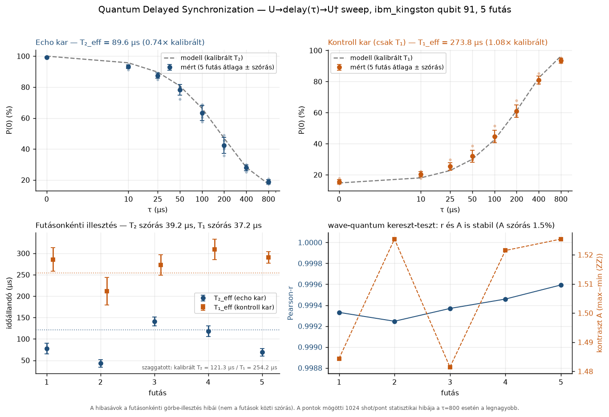

# Quantum Delayed Synchronization (QDS)

> ### 📄 Publication Manuscript Available
> - **LaTeX Manuscript:** [rxiv/delayed_sync_manuscript.tex](arxiv/delayed_sync_manuscript.tex)
> - **Title:** *Calibration-Quoted T2 Overestimates Random-Axis Echo T2 on a Drifting Superconducting Transmon: A T1 Control-Arm Arbitration*
> - **Target Venue:** *IEEE Transactions on Quantum Engineering* / *EPJ Quantum Technology*
> - **Key Empirical Finding:** On IBM Heron (ibm_kingston, Qubit 91), the T1 control arm matches calibration perfectly (ratio 1.08 +/- 0.11), while random-axis echo T2 drops to 89.6 +/- 17.5 us (vs. quoted 121.3 us), with replicate variance 3.6x Poisson noise (chi2 = 60.9).

> Késleltetett echók — a memória spine szinkronizálása kvantumállapotokkal  
> **2026-10-18-tól valódi IBM hardveren mérve** (ibm_kingston, 91-es qubit).  
> [English version](README.en.md)

## Mit mérünk?

A QDS a memória spine és a kvantumállapot koherens szinkronizációját vizsgálja.
A kísérlet egy random-axis **Hahn-echo (U-delay-U†) sweep**:

| kar | áramkör | mitől függ |
|---|---|---|
| **echo** | `U → delay(τ) → U†` | T₂ (fázis-koherencia) |
| **kontroll** | `U → delay(τ)` | **csak T₁** (relaxáció) |

8 τ-érték (0…800 µs), fix qubiten, 1024 shot/áramkör, 5 futás.

A **kontroll kar nem dísz**: mivel kizárólag T₁-től függ, ő az *időskála
referenduma*. Ha egy rejtett időskálázó hiba lenne, mindkét kar görbéjét
**ugyanazzal** az aránnyal tolná el — így a T₁-arányból megmondható, hogy a
T₂-eltérés valódi dekoherencia-e, vagy csak rossz `dt`-feltevés.
Lásd [`docs/QDS_CHRONICLE.md`](docs/QDS_CHRONICLE.md) FÁZIS 4.

## Fő eredmény

| mennyiség | érték |
|---|---|
| Kalibrált T₂ (91-es qubit) | 121,3 µs |
| **Echo-korlátozott T₂_eff** | **89,6 ± 17,5 µs** (SEM, 5 futás) — arány **0,74 ± 0,15** |
| T₁ a kontroll karból | 273,8 ± 37,2 µs → arány **1,08** → **a τ-tengely helyes** |
| Futások közötti ingadozás | T₂_eff szórás 39,2 µs (43–141 µs), a számított zaj **3,6×**-a, χ² = 60,9 (p ≈ 2·10⁻¹²) |
| T₁ ingadozás | χ² = 7,7 (p = 0,10) → **nem** szignifikáns |

A T₂-deficit **nem mérési hiba**: az IBM kalibráció statikus frekvenciát
feltételez, a random-axis echo pedig a delay alatti frekvencia-driftet nem
tudja visszafókuszálni. Az, hogy a relaxáció (T₁) stabil, a fázis-koherencia
(T₂) viszont futásról futásra ingadozik, éppen a drift-tézis mellett szól.

> **Amit ez NEM bizonyít** — új fizikát nem, és a Hope architektúráról semmit.
> A korlátok tételes listája: [`docs/QDS_REFEREE_STATS.md`](docs/QDS_REFEREE_STATS.md).



*Négy panel: az echo és a kontroll kar a kalibrált modellel szemben, a
futásonkénti illesztés (T₂ vs. T₁), és a wave-quantum kereszt-teszt. Az ábra a
`qds_plots.py`-jal újragenerálható — token és kvóta nélkül.*

## Telepítés

Python ≥ 3.10. A hardveres részhez **külön venv** ajánlott (a globális
Pythonba soha):

```bash
python -m venv .venv-qds
. .venv-qds/bin/activate            # Windows: .venv-qds\Scripts\activate

# szimulátor + kiértékelés (elég a legtöbb munkához)
pip install -e ".[dev]"

# hardveres futáshoz még:
pip install -e ".[hardware]"
```

> A korábbi dokumentáció `.venv-qds\Scripts\python.exe` Windows-útvonalakat
> használt — a parancsok most platformfüggetlenek.

## Futtatás

```bash
# 1. szimulátor (ingyenes, ~3 s) — MEDIAN zajmodell, NEM a 91-es qubit
python hahn_echo_t2_qam.py --mode simulate

# 2. kvótamentes elővizsgálatok
python qds_env_check.py            # verziók, delay→dt konverzió
python qds_preflight.py            # backend, qubit, kvóta (token kell)
python qds_target_probe.py         # dt/granularity, legjobb T₂-qubitek

# 3. hardver — ELŐSZÖR MINDIG dry-run (kvótát nem fogyaszt)
python hahn_echo_t2_qam.py --mode hardware --dry-run

# 4. éles hardveres mérés (IBM KVÓTÁT FOGYASZT)
python hahn_echo_t2_qam.py --mode hardware

# 5. több futás, időbeli eltolással (a drift kimutatására; KVÓTÁT FOGYASZT)
python qds_replicates.py --runs 4 --delay 75

# 6. kiértékelés (kvóta nélkül, a commitolt adatokon is lefut)
python qds_multirun_stats.py       # results/multirun_stats.json
python qds_analyze.py              # results/qam_echo_t2_results.json
python qds_detectability.py        # χ²-teszt: drift vs. zaj
python qds_axis_arbitration.py     # τ-tengely vs. valódi dekoherencia

# 7. kvóta nélkül is futó eszközök (a meglévő adatokból)
python qds_robustness.py           # bootstrap hibasáv, súlyozás, τ-tartomány
python qds_plots.py                # results/figures/qds_overview.png
python qds_wavezz_repeat.py --offline   # a wave-quantum ⟨ZZ⟩ újraszámolása
```

Ha a job lefutott, de a feldolgozás elszállt: **ne** küldj új jobot, a
`python qds_recover_job.py <JOB_ID>` ingyen visszakeresi az adatokat.

## Token

A hardveres futáshoz IBM Quantum API-kulcs kell, a repo gyökerében lévő
`ibm_token.json`-ban:

```json
{ "apikey": "..." }
```

A feloldási sorrend minden szkriptben ugyanaz: `--token`/paraméter →
`IBM_TOKEN_PATH` → `ibm_token.json`. A fájl **nincs** a repóban
(`.gitignore`), és a kulcs soha ne kerüljön commitba.

## Specifikáció

- Qubit: **91** (T₁ = 254,16 µs, T₂ = 121,26 µs a mérés pillanatában)
- Backend: `ibm_kingston` (Heron r2, 156 qubit)
- `opt_level=0`, `seed_transpiler=42`, θ = 2,3533 rad
- DD kikapcsolva, 1024 shot/áramkör
- A `delay` **µs-ban** van megadva → a transzpiler konvertálja dt-re
  (a target `dt`-je nominális, ezért a tengelyt empirikusan a kontroll kar igazolja)

## Repó felépítése

```
src/qds/               közös mag: konstansok, áramkör, modell, adat, IBM kapcsolat
src/qam_core.py        kompatibilitási réteg (QAM integrátor)
hahn_echo_t2_qam.py    mérőszkript (--mode simulate|hardware, --dry-run)
qds_*.py               elővizsgálat / mérés / kiértékelés szkriptek
tests/                 38 offline teszt (modell, sablon-hash, adat, ítélet)
results/               a mérés nyers és kiértékelt adatai (commitolva)
docs/                  krónika, bírálói korlátok, napló, adatséma
```

A konstansok (backend, qubit, τ-rács, szögek) **egy helyen**, a
`src/qds/constants.py`-ban vannak. A `theta/phi/lam` szándékosan explicit
konstans: a publikált `results/circuit_hashes.json` hash ezekből számolódik,
és a `tests/test_template.py` ellenőrzi, hogy a kódból újraszámolt hash
változatlan.

## Dokumentáció

| Fájl | Tartalom |
|---|---|
| [`MEASUREMENT_SUMMARY.md`](MEASUREMENT_SUMMARY.md) | számszerű eredmények, modellek, kvóta |
| [`docs/QDS_CHRONICLE.md`](docs/QDS_CHRONICLE.md) | a kutatás krónikája, **a hibákkal együtt** |
| [`docs/QDS_REFEREE_STATS.md`](docs/QDS_REFEREE_STATS.md) | mit bizonyít a mérés, és mit **nem** |
| [`docs/qds_measurement_log.md`](docs/qds_measurement_log.md) | mérési napló |
| [`docs/qds_raw_schema.md`](docs/qds_raw_schema.md) | nyers adatfájlok sémája |

## Adatok

```
results/
  result_runN_kingston_1024.json   egy-egy futás nyers számlálói
  raw_counts_all_runs.json         minden futás egy fájlban
  circuit_hashes.json              a sablon hash-e + módszertani megjegyzés
  multirun_stats.json              több futás statisztikája
  qam_echo_t2_results.json         kiértékelt eredmény (run 1)
  qam_echo_<JOB_ID>.json           job ID-ból visszakeresett nyers adat
  qam_echo_t2_dryrun.json          dry-run nyom (kvóta nélkül)
```

Licenc: MIT · Zenodo: `.zenodo.json` · Idézés: [`CITATION.cff`](CITATION.cff)

---

## 🤝 Contact & Research Collaboration

- **Author:** Máté Róbert
- **Email:** `materobi86@gmail.com`
- **GitHub:** [`silentnoisehun`](https://github.com/silentnoisehun)
- **Status:** **Open to research collaborations, academic partnerships, and joint QPU experimental campaigns** *(Nyitott vagyok kutatási együttműködésekre és közös publikációkra)*.
